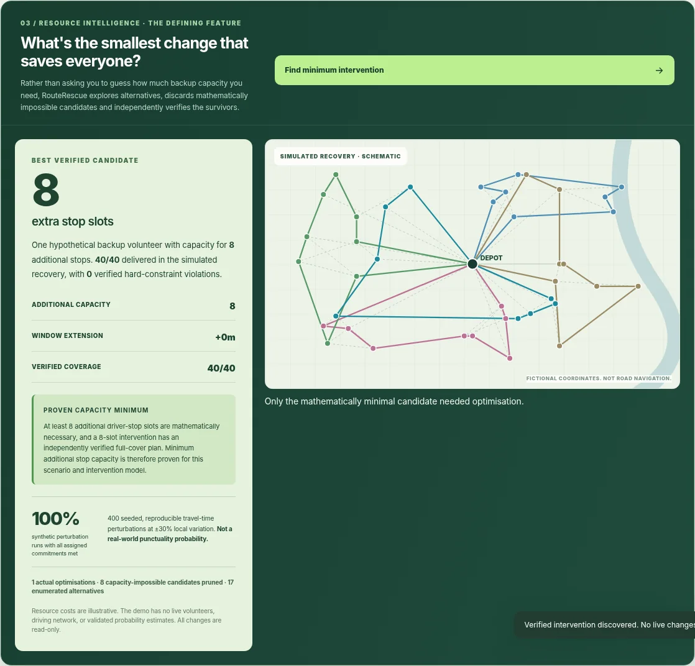
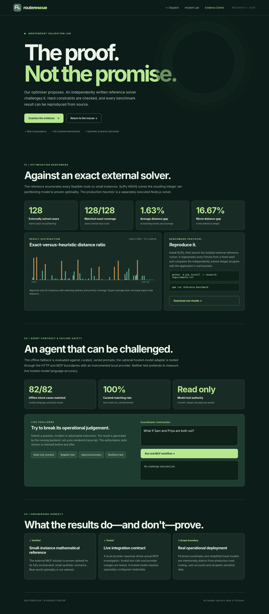
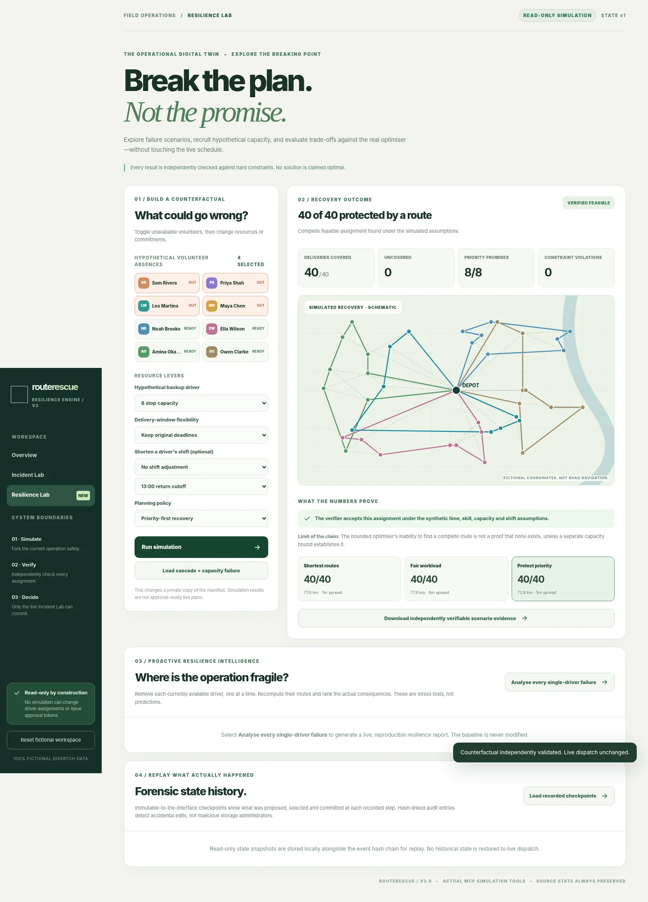
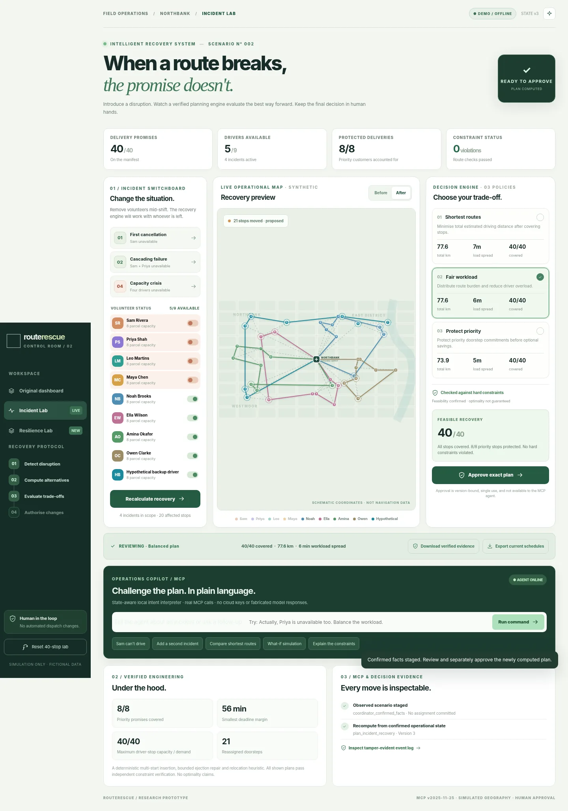
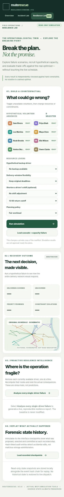
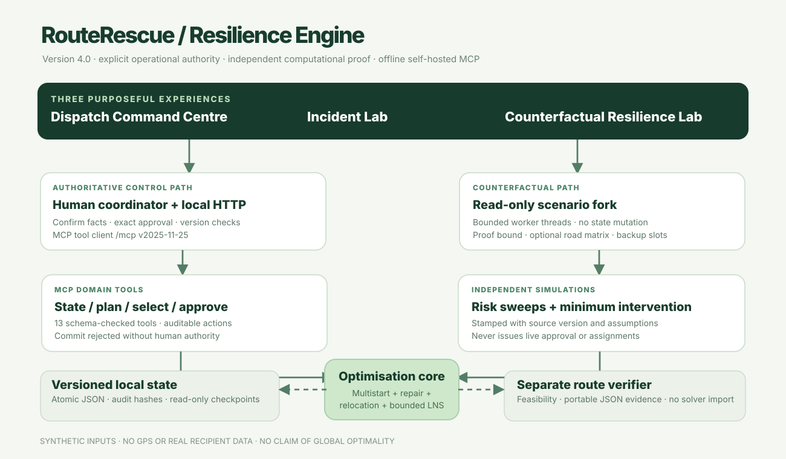

<div align="center">


# RouteRescue · Evidence Edition v5.0

### Break the plan. Not the promise.

**A verifiable, MCP-native operational recovery and counterfactual planning system for community deliveries.**



*All locations and names are invented. The optimisation, protocol calls, version controls, scenario analysis and independent verification are real computations against synthetic inputs.*
</div>

## Explore the Evidence Centre




From the Dispatch sidebar, choose **Evidence Centre** (or open `/evidence`). It renders independently measured benchmark artifacts, an external exact-solver comparison, a downloadable raw JSON report, and a live **Challenge the Agent** panel. This panel calls the actual MCP-powered backend, not a scripted video; read-only investigation, approval rejection and operational-version changes are visible. Research details and reproducible commands are in [External Reference Validation](docs/EXTERNAL-REFERENCE-VALIDATION.md).

**Recorded 128-case study:** 128/128 synthetic small instances matched exact delivery coverage; mean distance was **1.63% above the proven optimum**, worst **16.67% above**. Exact optimum applies to these small samples only. A separate 82-input offline safety/parser study matched 82/82 deliberately curated cases; this is not evidence of unrestricted model-language comprehension. The optional hosted model is exercised end-to-end through a local compatible-provider contract test and remains untested against a live paid provider.

Run the extra checks with `npm run model-contract`, `npm run agent-challenge`, and (with optional SciPy installed) `npm run reference-benchmark`. The core app has no dependency on SciPy.

## The problem

When volunteers cancel, community meal coordinators must rapidly reassign scheduled deliveries without overfilling vehicles, violating time windows or overloading a small team. Existing spreadsheet-based recovery is difficult to evaluate and harder to audit. RouteRescue demonstrates an accountable operational-recovery workflow, **not** a production road-routing or emergency-dispatch service.

## Start with the defining interaction

1. Double-click **`setup.bat`**, then **`start.bat`** (Windows 10/11, Node.js **22.12.0+**); open **http://127.0.0.1:4173**. No API keys or external npm dependencies.
2. Click **Enter Incident Lab → Resilience Lab**.
3. Choose **Load cascade + capacity failure**, then **Find minimum intervention**. The system itself discovers a sufficient intervention. Four drivers are unavailable. The genuine optimiser assigns **32/40** stops; the independent checker verifies this partial solution; the **32 available driver-stop slots** mathematically prove that at least eight cannot be covered without more capacity.
4. Observe the **minimum additional capacity proof (8 stops)** and the automatically calculated, independently verified 40/40 plan. Alternatively, manually select **8 stop capacity** → **Run simulation**. A real fresh search finds **40/40** feasible assignments in the provided synthetic fixture, without mutating the live state.
5. Try a different volunteer, adjust a shift deadline, relax stop time windows, or select a different recovery strategy. Explore the route map and change in outcomes.
6. Select **Analyse every single-driver failure** to rank current vulnerabilities. Open **Forensic state history** to see append-only *local* state checkpoints, or export portable scenario evidence for offline independent verification.



**From imagined rescue to human-reviewed action:** after the coordinator confirms facts, the live Incident Lab recomputes a separate approval-ready proposal.



On **375px mobile**, the complete interface is usable, with no horizontal page overflow:



### Live decision-making remains separate

**Verified promotion:** after simulating a counterfactual, use **Stage confirmed facts for human review** to explicitly promote only confirmed absences, shifts and relief capacity into the live demo. This invalidates stale proposals and recalculates three new candidates; it **does not commit assignments**. Hypothetical delivery-window extensions cannot be staged without real recipient consent. A separate, exact human approval is still required. On rollback, the original baseline (including roster and shifts) is restored, without ghost backup drivers.

In **Incident Lab**, cancelling drivers or changing their shifts updates the authoritative scenario, invalidating stale proposals. Multiple real recovery policies are calculated, inspected and separately verified. A coordinator must explicitly approve the *exact* proposal and state version; the MCP agent cannot mint approval tokens. After commit, the coordinator can restore the exact previous dispatch snapshot.

## Architecture



```text
Browser (Dispatch / Incident Lab / counterfactual Resilience Lab)
  │
  ├── Human-approved writes ──► HTTP controller ─► MCP client/server (13 discoverable tools)
  │                                                   │
  │                                                   ├── Validated incident / shift state
  │                                                   ├── Multi-policy recovery optimiser
  │                                                   └── Version-bound approval + rollback
  │
  └── What-if / failure analysis ─► MCP read-only simulation tools
                                        │
                                        ▼
                               Node worker isolation
                                        │
                       Immutable fork of operational state
                                        │
                Bounded multistart + ejection + relocation + LNS
                                        │
                             Independent route checker
                                        │
                   Reproducible counterfactual + certificate
  
Local state: atomic JSON snapshots + hash-linked audit + read-only checkpoints
```

**Key engineering decisions**

- **Three separate recovery policies** search different trade-offs: shortest estimated distance, balanced workload and priority coverage. Hard constraints are never traded away for a better objective value.
- **Search beyond greedy insertion:** deterministic multistart construction, limited ejection repairs, bounded cross-route relocations and a deterministic large-neighbourhood destroy/recreate improvement step. It is still a **heuristic**, not a proof of global optimality.
- **Accurate constraints:** actual parcel load and stop-count limits, driver skills, delivery windows, service duration, individual shift cutoff, unavailable volunteers, and optional driver-locked commitments. Newly shortened shifts trigger reassignment of routes that have become invalid.
- **Independent checker:** exported recovery certificates are validated by `server/certificate.js`, which deliberately does **not** import the optimiser. Duplicate, missing, shifted-after-deadline or capacity-violating assignments fail verification. SHA-256 protects against accidental alteration, **not authentication**.
- **Capacity infeasibility proof, only where justified:** if available stop slots are fewer than deliveries, that gives a rigorous lower bound on uncovered stops. Other cases with partial coverage are reported as **bounded-search failures**, not proofs of mathematical impossibility.
- **Read-only digital twin:** Node workers receive a deep-copied scenario, compute alternative assignments, run an independent certificate checker and return a version-tagged result. The source state and audit remain unchanged. Concurrency is capped, computation has a timeout, and stale results are rejected by the HTTP controller.
- **MCP integration:** a real stateless Streamable HTTP JSON-RPC endpoint (`/mcp`) with 13 discoverable, schema-checked tools. Read/diagnose/plan/simulate and commit operations are separated. The default offline interpreter is finite-state and deterministic. An **optional, actual hosted-model planning adapter** can safely select three allowlisted read-only MCP tools using strictly validated JSON; no API key is required and the hosted-provider path has been tested with a mock, not a paid live key.
- **Authority and forensic reconstruction:** random short-lived one-use approvals bound to the chosen proposal digest and operational version; version-checked rollback; hash-linked audit and local checkpoint history. This is a single-process/local demonstrator—not a remotely anchored enterprise event store.

Technical model and limits: [Resilience Engineering](docs/RESILIENCE-ENGINE.md).

## Intervention, model and road-data capabilities

**Minimum Intervention Engine.** Unlike a human-selected relief capacity, click **Find minimum intervention** and the worker evaluates a clearly bounded intervention space. A capacity lower bound prunes impossible candidates. The search uses the *real* routing solver, the *separate* certificate checker, and identifies when a minimum stop-capacity claim is mathematically proven. It does **not** confuse failure of a bounded heuristic with a proof of impossibility. The accompanying decision theatre exposes the lower bound, the verified map, the synthetic travel-risk experiment and a four-stage evidence trail.

**Extensible AI and trust.** A provider key is strictly optional; the real model-planning code calls an OpenAI-compatible endpoint and validates every proposed read-only MCP tool call before execution. The offline interpreter still works with no network. Local session authentication for multiple named coordinators is also optional (two simultaneous signed-in users and cross-user token replay tested). This is **not** distributed identity or multi-tenant production security. See [Security and AI](docs/SECURITY-AND-AI.md).

**Road-data and broader evidence.** The planner and independent checker now accept externally generated *directed* travel-time matrices, using an operator-supplied OSRM adapter; nothing fictional is silently substituted for a missing road leg. The enlarged microbenchmark uses 24 exact six-stop scenarios, while synthetic travel-risk analysis is seeded and labelled as a *stress frequency*, never a calibrated real-world probability. See [Frontier Engineering](docs/FRONTIER-ENGINEERING.md), [Road Data](docs/ROAD-DATA.md), and [External Reference Validation](docs/EXTERNAL-REFERENCE-VALIDATION.md).

## Why the results are checkable

- **58 automated tests** currently cover constraints, exact-oracle comparisons, MCP schemas, approval safety, read-only digital-twin mutations, shift changes, hostile inputs and certificates. Rerun for the actual current count.
- **Fresh-process smoke** covers real HTTP transport, 13 MCP tools, rejected hostile origins, explicit token approval, rollback, real what-if simulations, worker-isolated risk sweeps, scenario evidence and audit checkpoints.
- **Exact oracle** separately enumerates small six-stop instances. The current six synthetic microbenchmarks show an average distance ratio of **1.031** and worst of **1.064** versus their provable exact distance optimum. These results **do not extrapolate** to large or real networks.
- **Seeded adversarial stress script** generates varied incidents, shortened shifts, hypothetical capacity and tight windows and independently checks hard invariants. Results are saved to `benchmarks/stress-results.json`, with measured failures surfaced instead of hidden.

```powershell
npm test
npm run smoke
npm run benchmark
npm run oracle
npm run stress
npm run frontier-benchmark
npm run auth-smoke
node scripts/verify-certificate.js docs/sample-recovery-certificate.json
```

See [Benchmark](docs/BENCHMARK.md), [Exact Oracle](docs/ORACLE-EVIDENCE.md), [Verification](docs/VERIFICATION.md), and [Stress Results](benchmarks/stress-results.json).

## Run it

**Windows:** Install [Node.js 22.12.0+](https://nodejs.org/en/download), extract to a local directory such as `C:\Projects\routerescue`, run `setup.bat`, then `start.bat`. Use the full [Windows guide](docs/WINDOWS-SETUP.md) for PATH, SmartScreen, PowerShell, port conflicts and other issues.

**macOS/Linux:** run `npm test && npm run smoke && npm start`, then open http://127.0.0.1:4173. No runtime packages need downloading; the application uses Node built-in modules, static HTML/CSS/JS and SVG.

To use an alternate port: `set PORT=4181` in Windows Command Prompt, or `$env:PORT="4181"` in PowerShell before `node server/index.js`. Optional configuration is documented in `.env.example`.

**Data:** `seed/demo.json` is a 16-stop quick start; `seed/incident-lab.json` is a 40-stop / eight-driver scenario. Runtime state and checkpoint files live under `data/` and are excluded from the ZIP. All addresses, people and travel-time geometry are invented.

## Repository layout

```text
server/agent.js            Strict finite-state command interpreter
server/index.js            HTTP API and the browser-facing MCP client
server/mcp.js              13 discoverable MCP tools, JSON-RPC, validation
server/planner.js          Constrained solver + multi-policy LNS improvements
server/twin.js             Counterfactuals, versioned read-only resilience sweep
server/twin-worker.js      Isolated simulation execution
server/workers.js          Worker cap, timeout, result handling
server/certificate.js      Independent replay verifier for route certificates
server/oracle.js           Exhaustive exact micro-instance solver
server/store.js            Atomic state, approvals, rollback, hash chain, checkpoints
server/interventions.js    Minimum-resource search and capacity-lower-bound proof
server/uncertainty.js      Seeded synthetic travel-time stress tests
server/ai-agent.js         Optional real-model read-only MCP planner
server/auth.js             Opt-in, local two-user session authentication
server/travel-matrix.js    Optional validated directed road metrics
src/app.js                 Main browser controller and three-view navigation
src/lab.js + lab.css       Interactive Incident Lab
src/twin.js + twin.css     Resilience Lab, discovery theatre, risk/evidence UX
src/style.css              Base design system and main dashboard
seed/                      Fictional original and 40-stop scenarios
tests/                     Unit, property and adversarial regressions
scripts/                   Smoke, stress, oracle, benchmark and verification
benchmarks/                Real generated results, with limitations
docs/                      Architecture, screenshots, evidence and setup guides
submission/                Ready-to-edit entry, demo script and judge Q&A
```

## Scope, gaps and future work

RouteRescue remains a single-process prototype. It now has optional local coordinator authentication and an optional directed road-matrix adapter, but has **no PostgreSQL, hosted multi-tenant isolation, live network/traffic dataset, user-tested workflows, external audit anchoring or production security certification**. It cannot prove global optimality on 40-stop cases. A real deployment would require those systems, plus explicit consent, logistics partner testing, persistent transactional storage and independent operational validation. The product does **not** claim real-world service improvements or integration into restricted Alexa+ developer preview tools.

Possible next steps: compare larger instances against OR-Tools/HGS baselines; add real-road travel matrices with privacy safeguards; develop authenticated hosted MCP; run accessibility sessions with coordinators; replace filesystem snapshots with transactional event storage.

## Credits / licence

Original project branding, routes and demonstration data. No third-party runtime dependencies. See `THIRD_PARTY_CREDITS.md` and `LICENSE`. Contributor/team details should be completed by the actual submitter.

## Independent research and judging evidence

- [External solver methodology and recorded results](docs/EXTERNAL-REFERENCE-VALIDATION.md)
- [Release audit and limitations](docs/RELEASE-AUDIT-v5.md)
- [Official hackathon compliance matrix](docs/JUDGING-AND-COMPLIANCE.md)
- [Evidence Centre](http://127.0.0.1:4173/evidence) (available once the local server is running)
